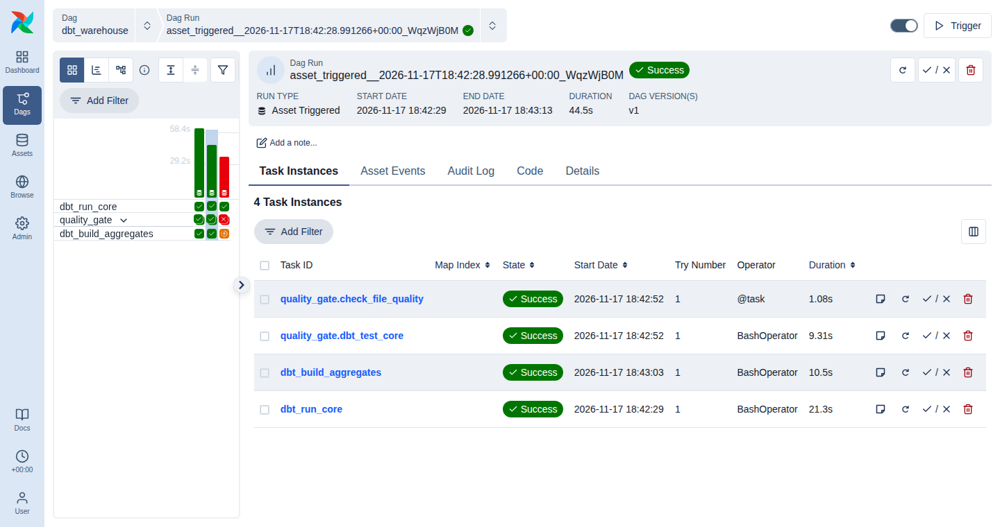
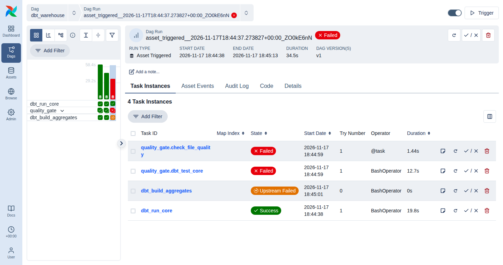
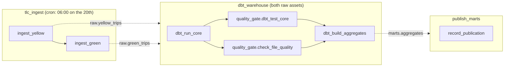

# airflow3-elt-pipeline

Apache Airflow 3 orchestrating a PostgreSQL + dbt warehouse of NYC taxi trips, with
asset-driven scheduling and a data quality gate that stops bad data from reaching the marts.

The warehouse itself (an incremental, idempotent loader for the monthly NYC TLC trip files and
a 22-model dbt project) is the sibling repo
[dbt-postgres-warehouse-demo](https://github.com/gkhnelbstn/dbt-postgres-warehouse-demo).
This repo adds what runs it: DAGs, scheduling, retries, alerting, backfills, the gate, a
Docker Compose stack, and tests.

**A run that passes the gate.** `dbt_warehouse` after a backfilled month: core models built,
both gate checks passed, the aggregates built. (The grid on the left also shows the later,
blocked run.)



**A run blocked by the gate.** The same DAG after a deliberately corrupted month (see
[Fault injection](#fault-injection-a-month-the-gate-must-block)): both gate checks failed, the
aggregates were never built (`upstream_failed`), and `publish_marts` did not run.



## What is in the repo

```
dags/tlc_ingest.py       monthly load of TLC yellow + green files, emits raw-table assets
dags/dbt_warehouse.py    dbt core models -> quality gate -> aggregates, emits the marts asset
dags/publish_marts.py    runs only when the marts asset updates (behind a passed gate)
dags/pipeline/           shared settings, asset definitions, failure alert callback
scripts/make_bad_month.py  builds a corrupted copy of a real TLC month for the fake CDN
scripts/e2e.sh           end-to-end check of both paths (used by CI)
tests/                   DAG integrity and unit tests
Dockerfile               Airflow 3.4.0 + the warehouse repo, pinned, in its own virtualenv
compose.yaml             Airflow (LocalExecutor) + PostgreSQL 17, plus an optional fake CDN
```

## How it works



**Ingestion.** `tlc_ingest` runs on the 20th of each month and loads the TLC month two months
earlier (TLC publishes with about that delay), or the month given in the `month` param. Each
task calls the warehouse repo's `tlc-ingest` CLI, which skips a file whose published version
(ETag) was already loaded, so retries and re-runs are safe. On success a task emits an event on
its raw-table asset; the month, the outcome (`loaded` / `already_loaded`), the row counts and
the file version go into the event's `extra`, for example
`{"dataset": "yellow", "month": "2026-07", "outcome": "loaded", "file_rows": 3530109, "raw_rows": 50000, ...}`. Assets are fixed when a DAG is parsed, so there is
one per raw table, not one per month.

**dbt.** `dbt_warehouse` is scheduled on `raw.yellow_trips & raw.green_trips`: one `tlc_ingest`
run emits both, so one dbt run follows. Several queued events collapse into one run, which is
fine because the warehouse's incremental models read from `raw.load_log` which months changed,
not from the events. dbt runs as plain `BashOperator` calls with selectors in three steps, so the
gate is a visible step in the UI instead of something buried inside one `dbt build`:

| Task | Command |
|---|---|
| `dbt_run_core` | `dbt seed && dbt run --exclude path:models/marts/aggregates` (staging, `fct_trips`, dimensions, `mart_file_quality`) |
| `quality_gate.dbt_test_core` | `dbt test --exclude path:models/marts/aggregates` (all keys, relationships, `is_reconciled`) |
| `quality_gate.check_file_quality` | per file in `mart_file_quality`: `is_reconciled` and `valid_pct >= QUALITY_MIN_VALID_PCT` (90 by default) |
| `dbt_build_aggregates` | `dbt build --select path:models/marts/aggregates`, emits `marts.aggregates` |

I chose this over Astronomer Cosmos: dbt lives in its own virtualenv, and turning the project's
105 dbt nodes into Airflow tasks would add scheduler load on a laptop without making the gate
any clearer.

**What "blocked" means.** If either gate check fails, `dbt_build_aggregates` is
`upstream_failed`, no `marts.aggregates` event is emitted, and `publish_marts` (the stand-in for
"refresh dashboards"; it writes row counts to `ops.publish_log`) does not run. The gate tasks
have no retries: a failed check is a finding about the data, not a glitch.

**Retries and alerting.** Every other task retries twice with exponential backoff (2 minutes to
start). Every task has an `on_failure_callback` that runs once retries are used up: it logs an
`ALERT` line, and if `ALERT_WEBHOOK_URL` is set, posts `{"text": ...}` to it (Slack incoming
webhook format). No webhook is configured in this repo. Example from the blocked run's log:

```
ALERT :red_circle: dbt_warehouse.quality_gate.check_file_quality failed (run asset_triggered__2026-11-17T18:44:37.273827+00:00_ZO0kE6nN, try 1): ValueError: quality gate failed:
  yellow 2026-06: valid_pct 85.14 < 90.0
```

**How the two repos connect.** The `Dockerfile` downloads the warehouse repo at a release tag
(`WAREHOUSE_REF`, default
[`v1.0.0`](https://github.com/gkhnelbstn/dbt-postgres-warehouse-demo/releases/tag/v1.0.0)) and installs `tlc-ingest`, `dbt-core` and `dbt-postgres` into
`/opt/warehouse-venv`, apart from Airflow's own packages; `dbt deps` runs at build time. A pinned
git dependency alone would not work: the warehouse's wheel does not include its dbt project. To
move to a newer warehouse version, change `WAREHOUSE_REF` (a tag, branch or commit SHA) and
rebuild.

## Run it

Requirements: Docker (the running stack used about 1.8 GB of memory in the measurements below;
PostgreSQL is capped at 2 GB by `PG_MEM_LIMIT`), and internet access to the TLC CDN.

```bash
cp .env.example .env    # then set AIRFLOW_JWT_SECRET and WAREHOUSE_PASSWORD
docker compose up -d --wait
```

Open http://localhost:8080 (no login; the UI is bound to 127.0.0.1 and everyone is admin, which
is fine for a local demo only). If port 8080 is taken, set `AIRFLOW_PORT` in `.env`. The
warehouse PostgreSQL is on `127.0.0.1:5433` (user `warehouse`, database `warehouse`), so it
does not clash with the warehouse repo's own database on 5432.

DAGs start paused. Unpause `publish_marts`, `dbt_warehouse` and then `tlc_ingest`. Because
`catchup` is off, unpausing `tlc_ingest` creates one run for its latest schedule (on 2026-11-17
that was the 2026-10-20 run, which loads 2026-08), and the other two DAGs follow through the
assets.

By default every trip file is cut to its first 50,000 rows (`TLC_MAX_ROWS`), the same sample
the warehouse repo's CI uses. Set `TLC_MAX_ROWS=0` for whole files; the warehouse repo
documents what 24 full months take (about 42 GB of database).

### Backfill

Airflow 3's backfill creates the runs, the scheduler executes them, and each run's asset events
trigger `dbt_warehouse`:

```bash
docker compose exec airflow-scheduler airflow backfill create --dag-id tlc_ingest \
    --from-date 2026-09-20 --to-date 2026-10-20
```

Runs whose logical date already has a run are skipped (the default reprocess behaviour), so
here it created only the 2026-09-20 run, which loaded 2026-07. A one-off month can also be
triggered with the `month` param: `airflow dags trigger tlc_ingest --conf '{"month": "2026-05"}'`.

### Fault injection: a month the gate must block

`scripts/make_bad_month.py` downloads a real TLC month and writes a damaged copy into
`faults/www` (git-ignored, nothing is committed). The green file and the zone lookup are copied
unchanged. In the yellow file every 8th row gets `PULocationID = 999` (a zone that does not
exist) and swapped pickup and dropoff times (negative duration). A small nginx container plays
the TLC CDN for those files, and the ingest run is pointed at it with the `base_url` param:

```bash
docker compose run --rm airflow-cli bash -c \
    "/opt/warehouse-venv/bin/python /opt/airflow/scripts/make_bad_month.py --month 2026-06"
docker compose --profile faults up -d fake-cdn
docker compose exec airflow-scheduler airflow dags trigger tlc_ingest \
    --conf '{"month": "2026-06", "base_url": "http://fake-cdn"}'
```

What happened on 2026-11-17: the script damaged 479,656 of 3,837,248 rows; the loader took the
first 50,000, 6,250 of them damaged. Both gate checks failed:

- `dbt_test_core`: `FAIL 6250 relationships_fct_trips_pickup_zone_id__zone_id__ref_dim_zone_`
  (PASS=44, ERROR=1);
- `check_file_quality`: `yellow 2026-06: valid_pct 85.14 < 90.0` (at that point the clean
  yellow months were at 97.49 and 97.67%, the green months at 99.52 to 99.66%).

**Recovery.** Trigger the month again from the real CDN
(`--conf '{"month": "2026-06"}'`). The real file has a different version from the one the
fake CDN served, so the loader replaces the month; `fct_trips` rebuilds it; the gate passes
(`valid_pct` 97.31) and `publish_marts` runs. In Airflow's asset event history,
`marts.aggregates` has one event per passed gate and none for the blocked run. Done on the same stack, 2026-11-17.

## Tests and CI

```bash
docker run --rm -v "$PWD:/repo" -w /repo --entrypoint bash airflow3-elt:local \
    -c "pip install -q pytest==8.4.2 && python -m pytest -q"
```

- **DAG integrity** (`tests/test_dag_integrity.py`): no import errors, exactly the three DAGs, no
  cycles, tags and docs on every DAG, `max_active_runs=1`, retries on every task except the two
  gate checks, the alert callback on every task, the cron and asset schedules, the gate sitting
  between the core models and the aggregates, and `dbt_build_aggregates` as the only producer of
  `marts.aggregates`.
- **Unit tests** (`tests/test_units.py`): month arithmetic, the ingest command, the gate's rules,
  the alert text and webhook behaviour.

[CI](.github/workflows/ci.yml) has two jobs:

1. `lint-and-dag-integrity`: Airflow 3.4.0 installed with uv against the official constraints
   file, `ruff`, then the 22 tests. 17 s on the first PR run.
2. `end-to-end`: builds the image (layer cache in GitHub Actions), starts the compose stack and
   runs `scripts/e2e.sh 2026-08 2026-07`: a good month must go through all three DAGs, then a
   corrupted month must fail both gate checks, leave the aggregates `upstream_failed` and not
   start `publish_marts`. 8 min 46 s on the first PR run, with a cold build cache.

## Measured

One run of the steps above on a Windows 11 laptop (16 logical cores, 32 GB RAM, Docker
Desktop), on 2026-11-17, with the default 50,000-row sample:

| | |
|---|---|
| Image `airflow3-elt:local` | 3.92 GB |
| `docker compose up -d --wait` (image already built) | 103 s |
| `tlc_ingest`, 2026-08 (first run, includes downloads) | 36 s |
| `tlc_ingest`, 2026-07 (backfill) | 16 s |
| `dbt_warehouse`, first run | 58 s |
| `dbt_warehouse`, after the backfill | 44.5 s |
| `dbt_warehouse`, blocked by the gate | 34.5 s |
| `publish_marts` | 1.4 to 2.2 s |
| Memory after these runs (`docker stats`) | scheduler 983 MiB, API server 313 MiB, DAG processor 230 MiB, PostgreSQL 242 MiB |
| `warehouse` database, 3 sample months | 144 MB |

Times include downloads from the TLC CDN, so they depend on the connection.

## Limits

- LocalExecutor and the simple auth manager with everyone as admin: a local demo setup, not a
  production deployment.
- The publication lag is a fixed two months. If TLC is late, the scheduled run fails after its
  retries (the loader reports a month that is not published) and alerts; trigger it again later.
- Orchestrating the full 24-month load was not measured here; the warehouse repo has those
  numbers for the loader and dbt on their own.

## License

Code: MIT (see `LICENSE`). Data: NYC TLC trip records, published by the City of New York.
